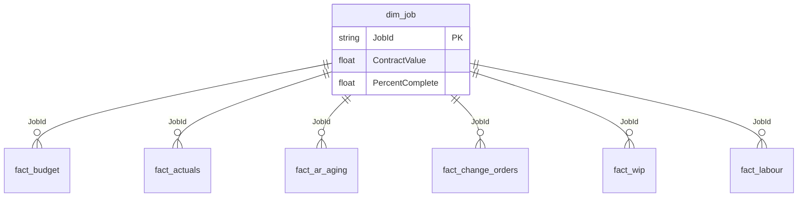

# Construction Financial Dashboard (Power BI)

Portfolio demo for a **construction company financials** model: QuickBooks-style actuals combined with budget spreadsheets, WIP, AR aging, change orders, and labour cost per job.  
All figures are **synthetic**.

## Problem

Owners and PMs need one place to see:

- Budget vs actual by job and category  
- Cash / P&L trends at company level  
- Job profitability, WIP, and backlog  
- Labour cost intensity by job  

Spreadsheets and accounting exports alone do not give a trusted, refreshable view.

## Solution architecture

```
QBO-style actuals CSV  ─┐
Budget spreadsheet CSV ─┼→ Power Query  → Star / snowflake model → Power BI pages
AR / CO / WIP / Labour ─┘
```

**Preferred platform:** Power BI Desktop + Power BI Service (Import mode for this demo).

### Star / analytic schema



## Documented report pages

| Page | Intent |
|------|--------|
| **Company** | Budget vs actual, cash/P&L-style trends, AR aging summary |
| **Construction** | Job profitability, WIP over/under billing, backlog remaining |
| **Labour** | Hours and cost per job / craft |

## How to open in Power BI Desktop

1. **Get data** → Text/CSV → load every file in `data/sample/`.
2. Relationships: all facts → `dim_job[JobId]` (Many:1). See `model/relationships.md`.
3. Create a **Date** table from `Period` / `WorkDate` / `InvoiceDate` (or use Auto date/time carefully).
4. Add measures from `dax/financial_kpis.dax`.
5. Build three pages matching the table above.

## Sample KPIs

| KPI | Notes |
|-----|-------|
| Budget vs Actual variance | Actual − Budget; % variance |
| Gross margin proxy | Contract / earned − cost to date |
| Over / under billing | From WIP snapshot |
| AR outstanding | Amount − AmountPaid by aging bucket |
| Labour cost per job | Hours × rate aggregated |

## Skills demonstrated

- Combining accounting actuals + budget files in one model  
- Variance and WIP-style DAX for construction finance  
- Multi-page owner dashboard design  
- Power Query typing and category unpivoting patterns  
- Refresh / handover documentation for non-technical owners  

## Licence

MIT — synthetic demo data only.
